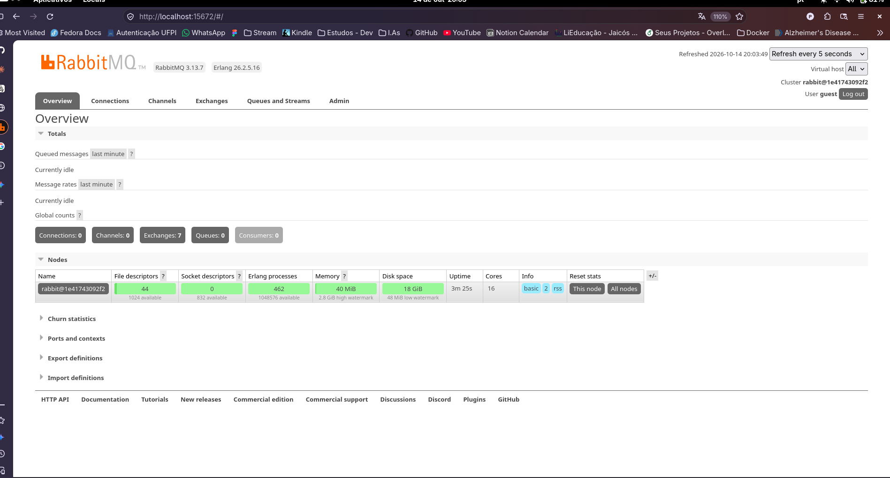
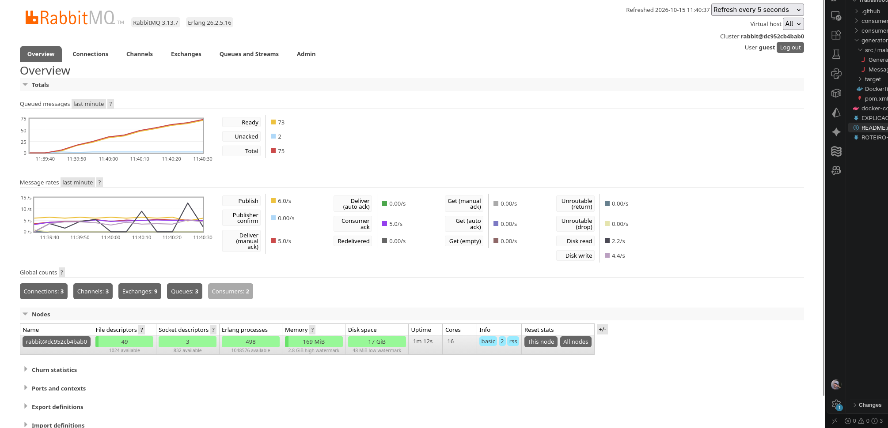
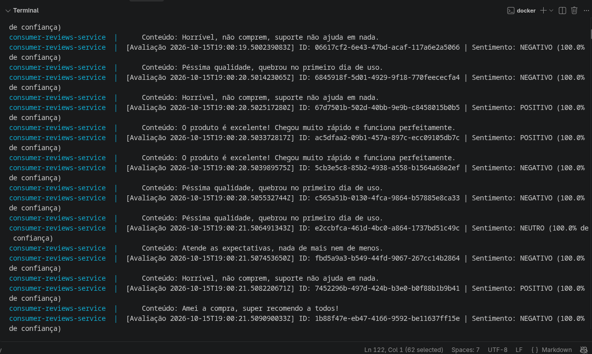
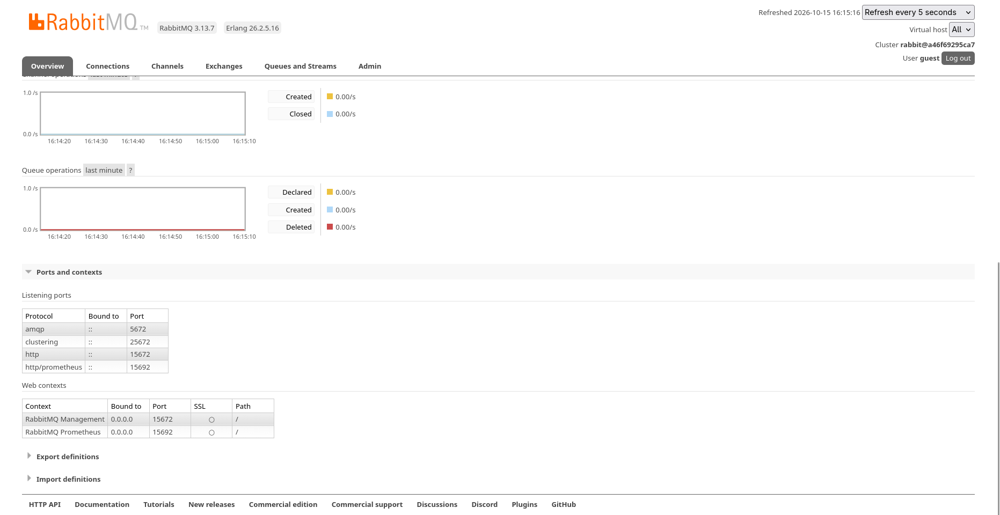
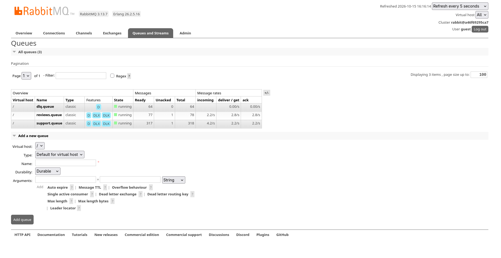

# Atividade 5 – Sistema Distribuído de Classificação Inteligente de Mensagens com RabbitMQ

Sistema distribuído desenvolvido em **Java 17**, orquestrado com **Docker Compose**, que utiliza
**RabbitMQ (Topic Exchange)** para transportar mensagens e **Inteligência Artificial embarcada
(biblioteca [Smile](https://github.com/haifengl/smile))** para classificar automaticamente
avaliações de produtos (análise de sentimento) e solicitações de suporte (categorização de problemas).

## 1. Arquitetura

```
                          ┌─────────────────────────────────────────────────────┐
                          │                    RabbitMQ                         │
                          │                                                     │
 ┌────────────┐  6 msg/s  │  ┌───────────────────────┐   routing key             │
 │            │──────────►│  │   Topic Exchange      │   "review.product"        │
 │  Gerador   │           │  │   app.topic.exchange  │──────────────┐            │
 │ (Java)     │──────────►│  │                       │   routing key │          │
 │            │  JSON     │  └───────────────────────┘   "support    │          │
 └────────────┘           │                                 .request" │          │
                          │                                     │    │          │
                          │         ┌───────────────────────────┘    │          │
                          │         ▼                                ▼          │
                          │  ┌──────────────────┐         ┌──────────────────┐  │
                          │  │  reviews.queue   │         │  support.queue   │  │
                          │  └────────┬─────────┘         └────────┬─────────┘  │
                          │           │  x-dead-letter-exchange    │            │
                          │           ▼                            ▼            │
                          │  ┌──────────────────┐         ┌──────────────────┐  │
                          │  │    dlq.queue     │◄────────┤   dlq.exchange   │  │
                          │  └──────────────────┘  nack   └──────────────────┘  │
                          └─────────────────────────────────────────────────────┘
                             ▲                                   ▲
                             │ ACK manual                        │ ACK manual
                      ┌──────┴───────────┐              ┌────────┴───────────┐
                      │  Consumidor 1    │              │   Consumidor 2     │
                      │  Análise de      │              │   Classificação de │
                      │  Sentimento      │              │   Solicitações     │
                      │  (IA: KNN/Smile) │              │   (IA: Reg. Logística/Smile)
                      └──────────────────┘              └────────────────────┘
```

**4 containers Docker** conectados à rede `app-net` (bridge), configurados via `docker-compose.yml`:

| Container | Imagem / Build | Função |
|---|---|---|
| `rabbitmq-node` | `rabbitmq:3-management` | Broker AMQP com Topic Exchange + interface de administração |
| `generator-service` | `./generator` (Maven + JRE 17) | Gera e publica mensagens continuamente (≥ 5 msg/s) |
| `consumer-reviews-service` | `./consumer-reviews` | Consome avaliações e classifica o **sentimento** com IA |
| `consumer-support-service` | `./consumer-support` | Consome solicitações e classifica a **categoria** com IA |

## 2. Fluxo de mensagens

1. O **gerador** publica no Topic Exchange `app.topic.exchange` mensagens JSON com as *routing keys*:
   - `review.product` — avaliações de produtos (positivas, negativas ou neutras)
   - `support.request` — solicitações de suporte (problemas técnicos)
2. O Topic Exchange encaminha cada mensagem **apenas para a fila compatível** com a sua routing key:
   - `review.product` → `reviews.queue` (consumidor 1)
   - `support.request` → `support.queue` (consumidor 2)
3. Cada consumidor processa a mensagem com sua **IA embarcada**, exibe o resultado no console e
   envia **confirmação manual (ACK)**.
4. Mensagens com **erro de processamento** (ex.: JSON malformado) recebem **NACK** e são
   encaminhadas via `x-dead-letter-exchange` para a **Dead Letter Queue** (`dlq.queue`),
   em vez de serem descartadas.

### Formato da mensagem

```json
{
  "id": "550e8400-e29b-41d4-a716-446655440000",
  "timestamp": "2026-10-14T18:32:05.123Z",
  "type": "review",
  "content": "O produto é excelente! Chegou muito rápido e funciona perfeitamente."
}
```

Cada mensagem contém **identificador único (UUID)**, **data/hora de geração**, **tipo** e **conteúdo**.
O gerador publica **6 mensagens por segundo** (misturando os dois tipos). A cada 10 segundos é
publicada também uma **mensagem malformada** (JSON inválido) em cada routing key, para
demonstrar o funcionamento da DLQ.

## 3. As duas IAs (biblioteca Smile)

Ambos os consumidores usam a biblioteca **Smile** (*Statistical Machine Intelligence and
Learning Engine*), que roda embarcada no próprio container (sem chamadas a serviços externos).
O pipeline de classificação é o mesmo dos textos, com algoritmos diferentes em cada consumidor:

**Pipeline comum (processado no startup de cada consumidor):**
1. **Tokenização**: texto em minúsculas, remoção de acentos e separação por não-alfanuméricos.
2. **Remoção de *stopwords*** (preposições, artigos etc. do português).
3. **Vocabulário**: construído a partir da base rotulada de treinamento (30 exemplos por consumidor).
4. **Vetorização (Bolsa-de-Palavras)**: cada texto vira um vetor de contagem de termos.
5. **Treinamento**: o modelo é ajustado na base rotulada uma única vez, na inicialização.

| | Consumidor 1 – Sentimento | Consumidor 2 – Suporte |
|---|---|---|
| **Algoritmo (Smile)** | **KNN** – k-Nearest Neighbors (k = 1) | **Regressão Logística Multinomial** |
| **Chamada** | `KNN.fit(x, y, 1)` | `LogisticRegression.fit(x, y)` |
| **Classes** | POSITIVO, NEGATIVO, NEUTRO | Problema de acesso, Problema de desempenho, Problema de conexão |
| **Saída** | rótulo + % de confiança | rótulo + % de confiança |

Exemplo de saída no console:

```
 [Avaliação 2026-10-14T18:32:05Z] ID: 550e8400-... | Sentimento: POSITIVO (100.0% de confiança)
     Conteúdo: O produto é excelente! Chegou muito rápido e funciona perfeitamente.
 [Suporte 2026-10-14T18:32:06Z] ID: 8f14e45f-... | Categoria: Problema de conexão (74.2% de confiança)
     Conteúdo: Erro de timeout de conexão ao conectar com o banco.
```

## 4. Como executar

**Pré-requisito:** Docker Engine com Docker Compose funcionando.

Na raiz do repositório, execute:

```bash
# 1. (Opcional) Para e remove containers/rede de uma execução anterior;
#     as filas começam vazias pois não há volumes persistentes no Compose
docker compose down -v --remove-orphans

# 2. Constrói as imagens dos 3 serviços Java e sobe os 4 containers
#    (-d roda em segundo plano; omita para ver os logs no terminal)
docker compose up -d --build

# 3. Confere se todos os 4 containers estão Up (o rabbitmq aparece como "healthy")
docker compose ps
```

### Acompanhar a execução

```bash
# Segue em tempo real os logs do gerador (mensagens publicadas + routing keys)
docker compose logs -f generator

# Segue os logs dos consumidores (classificações da IA + envio à DLQ)
docker compose logs -f consumer-reviews
docker compose logs -f consumer-support

# Lista mensagens/consumidores de cada fila direto no broker
docker exec rabbitmq-node rabbitmqctl list_queues name messages messages_ready messages_unacknowledged consumers
```

### Interface de administração do RabbitMQ

Acesse **http://localhost:15672** (usuário/senha: `guest`/`guest`) e observe na aba **Queues**:

- `reviews.queue` e `support.queue` — as filas **crescem continuamente**, pois os consumidores
  processam mais devagar (~350 ms e ~450 ms por mensagem) do que a taxa de chegada (≈ 3 msg/s
  por fila). É o efeito esperado de um sistema distribuído sob carga.
- `dlq.queue` — recebe as mensagens com erro de processamento (as malformadas enviadas pelo gerador).

No CLI do broker também dá para conferir:

```bash
docker exec rabbitmq-node rabbitmqctl list_queues name messages consumers
```

### Demonstrando a Dead Letter Queue (DLQ)

1. O gerador envia uma mensagem **malformada** (JSON inválido) a cada 10 segundos.
2. O consumidor falha ao desserializar, faz **NACK** (`basicNack(..., requeue=false)`) e a mensagem
   vai para `dlq.queue` via *dead-letter exchange* `dlq.exchange`.
3. No console do consumidor aparece: `[!] Erro ao processar mensagem... Enviando para a DLQ`.
4. Na interface do RabbitMQ, a fila `dlq.queue` apresenta mensagens acumuladas.

### Parar o sistema

```bash
docker compose down
```

## 5. Regras técnicas atendidas

- [x] 4 serviços em containers Docker na mesma rede (`app-net`)
- [x] RabbitMQ com **Topic Exchange** (`app.topic.exchange`) e routing keys `review.product` / `support.request`
- [x] Uma fila específica por consumidor (`reviews.queue`, `support.queue`)
- [x] Interface de administração habilitada (porta 15672)
- [x] Gerador produz ≥ 5 mensagens por segundo
- [x] Mensagens com ID único, data/hora, tipo e conteúdo (JSON)
- [x] Cada consumidor com sua própria IA embarcada baseada em Smile (KNN e Regressão Logística)
- [x] Consumidores processam mais lentamente que a chegada → crescimento visível das filas
- [x] **Confirmação manual de consumo** (`basicAck` após o processamento)
- [x] Erros de processamento encaminhados a uma **Dead Letter Queue** (`basicNack` + `x-dead-letter-exchange`)
- [x] Configuração de todos os serviços via **Docker Compose**

## 6. Estrutura do repositório

```
.
├── docker-compose.yml          # Orquestração dos 4 containers
├── README.md                   # Este documento (apresentação)
├── EXPLICACAO.md               # Explicação detalhada do funcionamento
├── generator/                  # Gerador de mensagens
│   ├── Dockerfile
│   ├── pom.xml
│   └── src/main/java/com/distribuidos/
│       ├── GeneratorApp.java   # Publicação contínua + mensagens malformadas (DLQ)
│       └── Message.java        # Modelo da mensagem (id, timestamp, type, content)
├── consumer-reviews/           # Consumidor 1 – Análise de sentimento (KNN/Smile)
│   ├── Dockerfile
│   ├── pom.xml
│   └── src/main/java/com/distribuidos/
└── consumer-support/           # Consumidor 2 – Categorização de suporte (Reg. Logística/Smile)
    ├── Dockerfile
    ├── pom.xml
    └── src/main/java/com/distribuidos/
```

## 7. Tecnologias

- **Java 17** — serviços (produção/consumo AMQP e IA)
- **Apache Maven** — build (JAR *fat jar* via maven-shade-plugin)
- **RabbitMQ 3** com management plugin — Topic Exchange, DLQ, interface web
- **Smile 3.0.2** — IA embarcada (KNN e Regressão Logística)
- **Jackson** — serialização/desserialização JSON
- **Docker / Docker Compose** — empacotamento e orquestração

## 8. Evidências de execução (prints)

Os prints abaixo foram obtidos durante uma execução real do sistema (`docker compose up`) e
ficam armazenados na pasta [`prints/`](prints) deste repositório.

### 8.1 RabbitMQ – broker recém-iniciado (antes da carga)



Aba **Overview** do painel de administração logo após subir o broker: sem conexões,
sem filas e sem consumidores registrados (apenas os *exchanges* default).

### 8.2 RabbitMQ – broker sob carga contínua (durante a execução)



Mesmo painel durante o funcionamento do sistema: 3 conexões e 2 consumidores ativos,
taxas de publicação de **6 msg/s** (acima das 5 exigidas) e entrega de ~5 msg/s, com 75
mensagens no total (73 *ready* + 2 *unacked*) acumuladas enquanto os consumidores
processam em ritmo deliberadamente menor.

### 8.3 Consumidor 1 – IA de sentimento em ação



Logs do `consumer-reviews-service`: avaliações negativas ("Horrível, não comprem...",
"Péssima qualidade..."), positivas ("O produto é excelente...") e neutras
("Atende as expectativas...") classificadas em runtime pelo KNN (Smile) com 100% de confiança.

### 8.4 RabbitMQ – portas e contexto de administração



Aba **Overview**: portas de escuta do broker — AMQP **5672**, HTTP de administração
**15672** e métricas **15692** — confirmando a interface de gestão habilitada.

### 8.5 RabbitMQ – filas crescendo (consumidor mais lento que o gerador)



Aba **Queues and Streams** evidenciando o *backpressure*: `reviews.queue` com 78
mensagens (77 *ready* + 1 *unacked*), `support.queue` com 318 (317 *ready* + 1 *unacked*;
entrada ~4.2/s contra entrega ~2.2/s) e `dlq.queue` com 64 mensagens — resultado das
mensagens MALFORMADAS enviadas periodicamente pelo gerador e rejeitadas com NACK
pelos consumidores, que as encaminham para a fila morta via *dead-letter exchange*.
